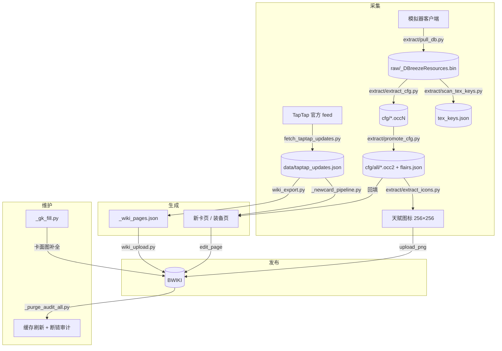

<div align="center">

# 百分之一 · BWIKI 更新工作流

**从「TapTap 官方公告」+「客户端解包」到「BWIKI 页面」的一整套自动化**

公告抓取 · 资源解包 · wikitext 生成 · 批量发布 · 图片补全 · 缓存刷新 · 断链审计

[](https://www.python.org/)
[](https://www.mediawiki.org/wiki/API:Main_page)
[](https://wiki.biligame.com/bfzy)
[](LICENSE)

为 [百分之一 BWIKI](https://wiki.biligame.com/bfzy) 打造

</div>

---

## 这是什么

一套把**游戏版本更新**变成 **WIKI 页面更新**的工具集。每周游戏发版后，跑一遍流程即可完成：

- 从 TapTap 官方 feed 抓取最新公告、卡池与新卡信息
- **从模拟器里把客户端配置表解包出来**，拿到星级、四维、技能、天赋、图标的真值
- 生成新角色 / 装备页的 wikitext，回填等级属性与天赋
- 批量发布到 BWIKI（`createonly` 防覆盖、断点续传、限速防 WAF）
- 同步公告链（当期新卡 / 首页轮播 / 公告一览 / 图鉴缓存键 / 更新说明文章页）
- 补图（立绘、256 头像、天赋图标）并做全站校验（四维自洽 / 红链 / 缺图）

> 这是针对 MediaWiki / BWIKI 的通用做法。脚本内容为「百分之一」定制，思路可移植到任意游戏 wiki（见[适配到其它 WIKI](#适配到其它-wiki)）。

## 工作流总览



## 每次版本更新的八步

| # | 做什么 | 入口 | 校验点 |
|---|---|---|---|
| 0 | 抓公告，解析卡池 / 新卡 / 密令宝库 / 超弦 | `fetch_taptap_updates.py` | 公告日期、卡池档位、下周超弦属性 |
| 1 | 拉热点库（约 1.9 GB） | `extract/pull_db.py` | 设备端大小与本地字节数一致 |
| 2 | 定向提取 cfg 表 + 提级 + 建贴图索引 | `extract/extract_cfg.py` → `promote_cfg.py` → `scan_tex_keys.py` | 三张锚点天赋名能解析出 Icon；表记录数只增不减 |
| 3 | 核对页面现状 | `_gk_fill.py` 的 `api()` | 新对象是否已存在、现有字段是否过期 |
| 4 | 建页 / 建装备页 | `_newcard_pipeline.py` | `createonly` 不覆盖；模板参数齐全 |
| 5 | 回填四维 / 等级属性 / 技能 / 天赋 | 批量 `action=edit` | 20 级四维与解包值逐项相等 |
| 6 | 更新公告链 | `wiki_announcements.py` + Widget | 当期新卡 / 首页轮播 / 公告一览计数 / 图鉴 CACHE_KEY / 更新说明文章页 |
| 7 | 补图 | `_gk_fill.upload_png()` + `extract/extract_icons.py` | 立绘 / 头像 / 天赋图标规格见下表 |
| 8 | 终验 | `_purge_audit_all.py` | 四维全站零差异；渲染 HTML 0 红链 0 缺图 |

## 图片规格

| 类型 | 尺寸 | 命名 | 说明 |
|---|---|---|---|
| 角色立绘 | 高 **828**，宽按原图等比 | `File:<角色名>.png` | 站内卡面统一 694×828；外源图等比缩到高 828 |
| 角色头像 | **256×256** | `File:<角色名>头像.png` | 从立绘头部裁方形，按 830×1174 口径映射 `crop(250, 60, 610, 420)` |
| 天赋图标 | **256×256** 白色线描 | `File:<天赋名>.png` | 直接取解包素材 `utex2.<flaircfgs.Icon>`，**不要截游戏图**（游戏内显示更小且带 tint） |
| 装备 / 灵武图标 | 512×512 | `File:<装备名>.png` | 已能定位到 `a_armament_*`，但解码仍有错位，暂缺（模板有守卫兜底） |

天赋图标是**纯白 + alpha**（游戏内靠 tint 上色），所以看起来"没有颜色"是正常的；
wiki 上历史图标同款，直接传原素材即可，不要做任何调色。

## 文件说明

| 文件 | 作用 |
|---|---|
| `fetch_taptap_updates.py` | 抓 TapTap 官方公告 feed → 解析新卡 / 卡池 / 技能 → 写入 `data/taptap_updates.json` |
| `wiki_export.py` | 读公告数据 + 图鉴数据，批量生成角色页 wikitext → `_wiki_pages.json` |
| `_newcard_pipeline.py` | 建页函数库：`build_char_page()` / `build_equip_page()`；`check_feed()` / `process()` 按需调用 |
| `wiki_upload.py` | 批量上传：`createonly=1` 绝不覆盖、断点续传、跳过审核队列、限速 |
| `wiki_batch_edit.py` | 对已有页面做批量字段替换 / 补录（依据 `_batch_plan.json`） |
| `wiki_announcements.py` | 公告文章页与「官方公告一览」的生成与更新 |
| `_gk_fill.py` | 公共 API 层（`api` / `get_token` / `purge_batch` / `upload_png`）+ 卡面图补全 |
| `_purge_audit_all.py` | 全站 `purge`（失效解析器缓存）+ 断链扫描 |
| `extract/` | **客户端解包链路**：拉热点库 → 提取 cfg → 提级 → 解纹理解图标，详见 [`extract/README.md`](extract/README.md) |
| `data/effect_words.json` | 技能效果词表（用于 `{{效果|…}}` 包裹与标签提取） |

### extract/（解包取真值）

| 脚本 | 作用 |
|---|---|
| `adb.py` | 纯 socket 实现的 adb 客户端（shell + sync RECV），不依赖 `adb.exe` |
| `pull_db.py` | 流式拉取 `_DBreezeResources`，约 12 MB/s |
| `extract_cfg.py` | 只扫需要的表名，按 occN 落盘（3 表约 3 秒） |
| `promote_cfg.py` | 取最新 occN 为权威；解析天赋表 → `flairs.json`（Name / Icon / TxtIcon / Desc） |
| `scan_tex_keys.py` | 全库建「贴图键名 → 偏移」索引 |
| `tex_decode.py` | **修正版** Unity Texture2D 解码（ETC2_RGBA8） |
| `extract_icons.py` | 按 `Icon` 字段批量导出天赋图标 |

### 数据文件说明

仓库只收录**代码与配置**；下列数据文件不随仓库分发（运行时生成或按需自备）：

| 文件 | 来源 |
|---|---|
| `data/taptap_updates.json` | 由 `fetch_taptap_updates.py` 抓取生成 |
| `data/characters.json`、`data/gamekee_cards.json` | 图鉴数据，自行整理 |
| `_wiki_pages.json` | 由 `wiki_export.py` 生成 |
| `raw/`、`cfg/`、`tex_keys.json`、`tex_out/` | 解包产物（GB 级，已在 `.gitignore`） |

`data/effect_words.json`（技能效果词表）已随仓库提供，可直接使用。

## 环境准备

```bash
pip install -r requirements.txt
```

**配置登录凭证** —— `_wiki_cookie.txt`（已加入 `.gitignore`，**绝不入库**）：

1. 浏览器登录 `wiki.biligame.com`，打开任意 wiki 页面
2. `F12` → **Network** → 点任一请求 → 复制请求头里的完整 `Cookie` 值
3. 粘贴进 `_wiki_cookie.txt`（单行；格式见 `_wiki_cookie.txt.example`）

```bash
cp _wiki_cookie.txt.example _wiki_cookie.txt   # 然后填入你的 Cookie
```

> 需要具备对应 wiki 的编辑权限（`edit` / `editwidgets` 等）。读取类脚本无需登录。
> 解包链路额外需要一个已安装该游戏的 Android 模拟器（MuMu 实例 0，adb 端口 16384）。

## 使用

```bash
# 1. 抓取最新官方公告
python fetch_taptap_updates.py

# 2.（可选）解包取真值：拉库 → 提表 → 建索引 → 导图标
python extract/pull_db.py --out raw/_DBreezeResources.bin
python extract/extract_cfg.py --src raw/_DBreezeResources.bin --out cfg
python extract/promote_cfg.py --src cfg --dst cfg/all --anchor 钢铁之躯,聚能刻印
python extract/scan_tex_keys.py --src raw/_DBreezeResources.bin --out tex_keys.json
python extract/extract_icons.py --flairs cfg/all/flairs.json --out tex_out/icons

# 3. 生成角色页 wikitext（产物：_wiki_pages.json）
python wiki_export.py

# 4. 干跑：校验登录与页面完整性，不提交任何内容
python wiki_upload.py --dry-run

# 5. 试传前 3 页
python wiki_upload.py --limit 3

# 6. 全量上传（自动跳过已成功页）
python wiki_upload.py

# 7. 刷新缓存 + 断链审计
python _purge_audit_all.py
```

`_newcard_pipeline.py` 提供 `build_char_page()` / `build_equip_page()` / `check_feed()` / `process()` 等函数，按需导入调用即可（生成结果同样用 `wiki_upload.py` 发布）。

## 关键机制与踩坑记录

长期维护中积累的经验 —— 这也是本仓库最有价值的部分：

| 机制 / 坑 | 说明 |
|---|---|
| **改模板必须 purge** | BWIKI **不会**在模板修改后自动失效页面解析缓存，`action=parse` 会继续返回旧 HTML。每次改模板后必须对依赖页执行 `action=purge` |
| **WAF 限流 567** | 搜索 / `parse` 连打会触发 567 拦截，请求间隔需保持 **3–6 秒** |
| **cookie jar 跟随 Set-Cookie** | 服务端会轮换 session，需用 cookie jar 自动跟随，且**每次写操作现取 csrf token** |
| **badtoken 要重取 token** | token 可能过期，写失败时应**刷新 token 重试**，而不是单纯重发请求 |
| **createonly=1** | 上传时用 `createonly`，**绝不覆盖**已有页面 |
| **审核队列** | BWIKI 可能返回 `moderation-edit-queued`（编辑进人工审核），应记录并**不重传** |
| **幽灵断链** | 页面出现 `[[file:.png]]` 这类红链，多半是**模板缓存陈旧**，并非真的缺文件 |
| **红链判据** | `action=parse&prop=links` 里 `exists:false` **不等于红链**（会把 `#ifexist` 探测的候选文件也算进去）。真判据看渲染 HTML：`wpDestFile=`（缺图）与 `redlink=1`（缺页） |
| **空参数生成红链** | 模板里留 `\|图标=` 这类空参数会拼出 `File:.png`。要么删参数（回退模板默认取名称），要么用 `#if` 守卫 |
| **图标名写错连带跳转错** | 改天赋图标名时必须**同步改** `天赋N名称` 与 `天赋标签`/`天赋标签2`，否则词条跳转仍指旧名 |
| **adb 端口 16384** | MuMu 实例 0 是 16384；部分机器 `adb.exe` 守护进程起不来，所以用纯 socket 实现 |
| **拉包必须流式** | 先收完再解析的实现会退化成 O(n²)，1.9 GB 跑不动；流式落盘约 12 MB/s |
| **纹理解码偏移** | UnityPy 用"第一个 1000<int32<20M"当数组长度，小图会抓到 2048 → 花屏。正解见 `extract/tex_decode.py` |
| **图标映射别猜拼音** | 天赋 Icon 必须取配置表 `flaircfgs.Icon` 字段；猜拼音会张冠李戴（灵力膨胀=icon_llpz，但 icon_496_llpz 是灵力屏障） |
| **禁系统代理** | 脚本内使用 `trust_env=False` / `ProxyHandler({})`，避免被本机失效代理卡死 |

## 适配到其它 WIKI

核心流程与站点无关，需要改的只有这几处：

1. `fetch_taptap_updates.py` 中的 `GROUP_ID` / `APP_ID`（换成目标游戏的 TapTap 话题与 App ID）
2. 各脚本里的 `API = 'https://wiki.biligame.com/<站点>/api.php'`
3. `_newcard_pipeline.py` 的 `build_char_page()` 中 `{{角色}}` 模板字段（换成目标 wiki 的模板）
4. `data/effect_words.json`（换成目标游戏的技能效果词表）
5. `extract/` 整条链路只对 Unity + DBreeze 的游戏成立；换成其它引擎时要重写 `extract_cfg.py` 与 `tex_decode.py`

## 免责声明

- 本工具为**非官方粉丝作品**，与游戏开发商 / 发行商、Bilibili 均无任何关联。
- 请遵守对应 wiki 的编辑规范与 API 使用政策，**合理限速**，勿滥用。
- 游戏名称、角色名称及相关内容版权归原权利方所有。

## License

[MIT](LICENSE)
