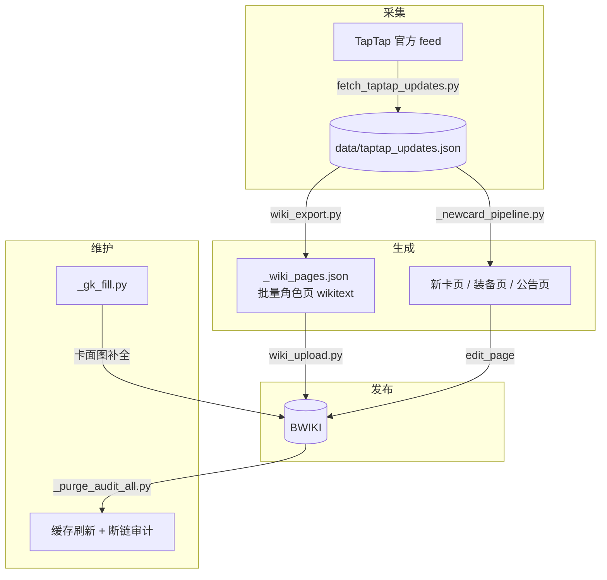

<div align="center">

# 百分之一 · BWIKI 更新工作流

**从「TapTap 官方公告」到「BWIKI 页面」的一整套自动化**

公告抓取 · wikitext 生成 · 批量发布 · 缓存刷新 · 断链审计

[](https://www.python.org/)
[](https://www.mediawiki.org/wiki/API:Main_page)
[](https://wiki.biligame.com/bfzy)
[](LICENSE)

为 [百分之一 BWIKI](https://wiki.biligame.com/bfzy) 打造

</div>

---

## 这是什么

一套把**游戏官方更新公告**自动转成 **WIKI 页面**的工具集。每周游戏发布更新公告后，跑一遍流程即可完成：

- 从 TapTap 官方 feed 抓取最新公告、卡池与新卡信息
- 生成新角色 / 装备页的 wikitext（技能效果词自动包裹、天赋、等级四维）
- 批量发布到 BWIKI（`createonly` 防覆盖、断点续传、限速防 WAF）
- 刷新解析器缓存（`purge`）并做全站断链审计

> 这是针对 MediaWiki / BWIKI 的通用做法。脚本内容为「百分之一」定制，思路可移植到任意游戏 wiki（见[适配到其它 WIKI](#适配到其它-wiki)）。

## 工作流总览



## 文件说明

| 文件 | 作用 |
|---|---|
| `fetch_taptap_updates.py` | 抓 TapTap 官方公告 feed → 解析新卡 / 卡池 / 技能 → 写入 `data/taptap_updates.json` |
| `wiki_export.py` | 读公告数据 + GameKee 数据，批量生成角色页 wikitext → `_wiki_pages.json`（供上传） |
| `_newcard_pipeline.py` | 建页函数库：`build_char_page()` / `build_equip_page()` 生成 wikitext；`check_feed()` / `process()` 供按需调用 |
| `wiki_upload.py` | 批量上传：`createonly=1` 绝不覆盖、断点续传、跳过审核队列、限速 |
| `wiki_batch_edit.py` | 对已有页面做批量字段替换 / 补录（依据 `_batch_plan.json`） |
| `wiki_announcements.py` | 公告文章页与「官方公告一览」的生成与更新 |
| `_gk_fill.py` | 公共 API 层（`api` / `get_token` / `purge_batch` / `upload_png`）+ GameKee 卡面图补全 |
| `_purge_audit_all.py` | 全站 `purge`（失效解析器缓存）+ 断链扫描 |
| `data/effect_words.json` | 技能效果词表（用于 `{{效果|…}}` 包裹与标签提取） |

### 数据文件说明

仓库只收录**代码与配置**；下列数据文件不随仓库分发（运行时生成或按需自备）：

| 文件 | 来源 |
|---|---|
| `data/taptap_updates.json` | 由 `fetch_taptap_updates.py` 抓取生成 |
| `data/characters.json`、`data/gamekee_cards.json` | 图鉴数据，自行整理 |
| `_wiki_pages.json` | 由 `wiki_export.py` 生成 |
| `_wiki_candidates.json`、`_batch_plan.json` | 批量编辑用的候选 / 计划文件，按需自建 |

`data/effect_words.json`（技能效果词表）已随仓库提供，可直接使用。

## 环境准备

```bash
pip install -r requirements.txt
```

**配置登录凭证** —— `_wiki_cookie.txt`（已加入 `.gitignore`，**绝不入库**）：

1. 浏览器登录 `wiki.biligame.com`，打开任意 wiki 页面
2. `F12` → **Network** → 点任一请求 → 复制请求头里的完整 `Cookie` 值
3. 粘贴进 `_wiki_cookie.txt`（单行；格式见 `_wiki_cookie.txt.example`）

```bash
cp _wiki_cookie.txt.example _wiki_cookie.txt   # 然后填入你的 Cookie
```

> 需要具备对应 wiki 的编辑权限（`edit` / `editwidgets` 等）。读取类脚本无需登录。

## 使用

```bash
# 1. 抓取最新官方公告
python fetch_taptap_updates.py

# 2. 生成角色页 wikitext（产物：_wiki_pages.json）
python wiki_export.py

# 3. 干跑：校验登录与页面完整性，不提交任何内容
python wiki_upload.py --dry-run

# 4. 试传前 3 页
python wiki_upload.py --limit 3

# 5. 全量上传（自动跳过已成功页）
python wiki_upload.py

# 6. 刷新缓存 + 断链审计
python _purge_audit_all.py
```

`_newcard_pipeline.py` 提供 `build_char_page()` / `build_equip_page()` / `check_feed()` / `process()` 等函数，按需导入调用即可（生成结果同样用 `wiki_upload.py` 发布）。

## 关键机制与踩坑记录

长期维护中积累的经验 —— 这也是本仓库最有价值的部分：

| 机制 / 坑 | 说明 |
|---|---|
| **改模板必须 purge** | BWIKI **不会**在模板修改后自动失效页面解析缓存，`action=parse` 会继续返回旧 HTML。每次改模板后必须对依赖页执行 `action=purge` |
| **WAF 限流 567** | 搜索 / `parse` 连打会触发 567 拦截，请求间隔需保持 **3–6 秒** |
| **cookie jar 跟随 Set-Cookie** | 服务端会轮换 session，需用 cookie jar 自动跟随，且**每次写操作现取 csrf token** |
| **badtoken 要重取 token** | token 可能过期，写失败时应**刷新 token 重试**，而不是单纯重发请求 |
| **createonly=1** | 上传时用 `createonly`，**绝不覆盖**已有页面 |
| **审核队列** | BWIKI 可能返回 `moderation-edit-queued`（编辑进人工审核），应记录并**不重传** |
| **幽灵断链** | 页面出现 `[[file:.png]]` 这类红链，多半是**模板缓存陈旧**，并非真的缺文件 |
| **禁系统代理** | 脚本内使用 `trust_env=False` / `ProxyHandler({})`，避免被本机失效代理卡死 |

## 适配到其它 WIKI

核心流程与站点无关，需要改的只有这几处：

1. `fetch_taptap_updates.py` 中的 `GROUP_ID` / `APP_ID`（换成目标游戏的 TapTap 话题与 App ID）
2. 各脚本里的 `API = 'https://wiki.biligame.com/<站点>/api.php'`
3. `_newcard_pipeline.py` 的 `build_char_page()` 中 `{{角色}}` 模板字段（换成目标 wiki 的模板）
4. `data/effect_words.json`（换成目标游戏的技能效果词表）

## 免责声明

- 本工具为**非官方粉丝作品**，与游戏开发商 / 发行商、Bilibili 均无任何关联。
- 请遵守对应 wiki 的编辑规范与 API 使用政策，**合理限速**，勿滥用。
- 游戏名称、角色名称及相关内容版权归原权利方所有。

## License

[MIT](LICENSE)
